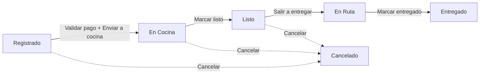

<div align="center">

# 🍔 PedidoCentral

**Centraliza y da seguimiento a los pedidos de la cocina oculta de comidas rápidas en El Cairo.**


</div>

---

## 📌 ¿Qué es?

Proyecto Django 5.2 sobre MySQL 8. Usa la base `pedidocentral` tal cual (tablas, triggers y procedimientos del `.sql`): Django se conecta a esas tablas y la interfaz web consume una API JSON del mismo proyecto.

> 📸 *Agrega aquí una captura o GIF de la pantalla principal:* ``

## 👥 Equipo

| Integrante |
|---|
| Luis Alandete |
| Santiago Angulo |
| Fabian Hernandez |

## 🔄 Flujo de un pedido

Las reglas las aplica la base de datos.



1. **Cajera** registra el pedido → `Registrado`.
2. Pega la foto del comprobante y pulsa **Validar pago** (RF-03). Si el pago es en **efectivo** no hace falta comprobante: se valida directamente.
3. **Enviar a cocina** → `En Cocina`; el temporizador pasa a rojo a los 20 min (RF-04).
4. **Cocina** pulsa **Marcar listo**.
5. **Domiciliario**: **Salir a entregar** → `En Ruta` y luego **Marcar entregado**.
6. Cancelar solo antes de salir a reparto. Todo queda en `historial_estado_pedido`.

## 📁 Estructura

```
config/            settings.py, urls.py, wsgi.py
pedidos/models.py  modelos que mapean las tablas del .sql (managed = False)
pedidos/views.py   API: login por rol, pedidos, acciones, resumen y reportes
pedidos/urls.py    rutas
pedidos/templates  index.html (pantalla única)
pedidos/static     app.js y styles.css (interfaz)
pedidos/management/commands/claves.py   asigna claves a los usuarios demo
database/          pedidocentral.sql y ajustes.sql
tests/flujo.py     prueba de humo del flujo completo (ver "Pruebas")
.env.example       plantilla de variables de entorno
```

## 🚀 Instalación

### 1. Base de datos (MySQL 8)

```bash
mysql -u root -p < database/pedidocentral.sql
mysql -u root -p pedidocentral < database/ajustes.sql
```

> ⚠️ `ajustes.sql` es necesario: agrega los 5 canales y el estado Cancelado, permite cancelar pedidos y permite validar pagos en efectivo sin comprobante.
>
> 🔄 **Si ya tenías la base creada** de una versión anterior, vuelve a ejecutar `ajustes.sql` (se puede repetir sin problema). Requiere MySQL 8.0.19+.

### 2. Ejecutar

```bash
python -m venv .venv
.venv\Scripts\activate          # Linux/Mac: source .venv/bin/activate
pip install -r requirements.txt
copy .env.example .env          # Linux/Mac: cp .env.example .env  (completa DB_USER y DB_PASSWORD; ya trae DJANGO_DEBUG=true)
python manage.py claves TuClave123
python manage.py runserver
```

Abre http://127.0.0.1:8000 e ingresa con `cajera`, `cocina`, `domi` o `admin`.

No hace falta `migrate`: las tablas las crea el `.sql` y las sesiones van en una cookie firmada.

## 🧪 Pruebas

`tests/flujo.py` recorre el flujo completo contra una base MySQL real (registrar → validar → cocina → listo → ruta → entregado), los casos de rechazo, el pago en efectivo, el límite de intentos de login y la cabecera anti-clickjacking.

> ⚠️ **Borra los pedidos de la base.** Por seguridad solo corre si el nombre de la base contiene `test`.

```bash
sed 's/pedidocentral/pedidocentral_test/g' database/pedidocentral.sql | mysql -u root -p
sed 's/pedidocentral/pedidocentral_test/g' database/ajustes.sql | mysql -u root -p pedidocentral_test
DB_NAME=pedidocentral_test python tests/flujo.py      # Windows (PowerShell): $env:DB_NAME="pedidocentral_test"; python tests/flujo.py
```

## 🔌 API

Requiere sesión y el encabezado `X-CSRFToken` en POST/PATCH.

| Método | Ruta | Rol |
|---|---|---|
| POST | `/api/login`, `/api/logout` | — |
| GET | `/api/yo`, `/api/pedidos`, `/api/resumen`, `/api/pedidos/<id>/historial` | Todos |
| POST | `/api/pedidos` (409 si hay duplicado; reenviar con `"forzar": true`) | Cajera, Admin |
| PATCH | `/api/pedidos/<id>/comprobante`, `validar-pago`, `enviar-cocina`, `cancelar` | Cajera, Admin |
| PATCH | `/api/pedidos/<id>/listo` | Cocina, Admin |
| PATCH | `/api/pedidos/<id>/retirar`, `entregar` | Domiciliario |
| GET | `/api/reportes` | Admin |

## ☁️ Publicar (Render, Railway...)

- **Variables:** `DJANGO_SECRET_KEY` (obligatoria), `DJANGO_ALLOWED_HOSTS`, `CSRF_TRUSTED_ORIGINS` (con `https://`), y las `DB_*` de una base MySQL en la nube (revisa que permita triggers y procedimientos almacenados). `DJANGO_DEBUG` ya viene apagado por defecto; no lo actives en producción.
- **Zona horaria:** `DB_TIME_ZONE=-05:00` (por defecto) fija la hora de Colombia en la conexión, así los reportes de "hoy" no dependen de la zona del servidor.
- **HTTPS:** con `DEBUG` apagado se activa la redirección a HTTPS y HSTS de 1 hora (`SECURE_HSTS_SECONDS`; súbelo a `31536000` cuando todo funcione). `/api/salud` queda exento de la redirección para el health check.
- **Build:** `pip install -r requirements.txt && python manage.py collectstatic --noinput`
- **Inicio:** `gunicorn config.wsgi`

